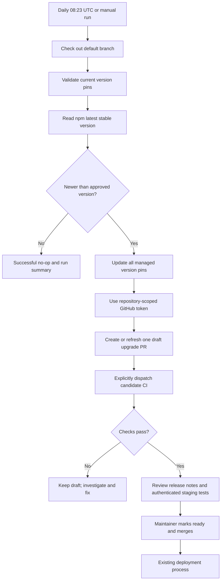

# Managed Codex upgrade automation

## Purpose and outcome

Detect new stable Codex CLI releases and turn them into reviewable draft pull
requests. Production continues to use the exact version approved in the default
branch. A release appearing on npm never changes a running broker.

The automation owns detection, coordinated version edits, and PR creation. CI
validates each candidate. A maintainer owns authenticated staging verification,
merging, and deployment. No automatic merge or deployment is configured.

## Flow



## High-level pseudocode

```text
on scheduled or manual trigger:
    acquire updater concurrency slot
    check out repository default branch
    read approved version from managed-codex-version.txt
    assert all generated version pins agree with approved version
    fetch @openai/codex npm latest metadata with a timeout
    assert package identity and stable major.minor.patch version format
    if candidate <= approved version:
        report no upgrade; exit successfully
    validate every expected pin location before writing files
    update manifest, Docker, Go compatibility, Nix module/fixture, README
    use the job-scoped GitHub token
    create or refresh automation/managed-codex-upgrade from default branch
    create/update draft PR with release link and review checklist
    explicitly dispatch CI on the candidate branch when created or updated
    report PR URL

on candidate CI dispatch (or a normal pull request):
    check version consistency and updater regression tests
    run existing Go, frontend/extension, and Nix CI checks
    build the Docker runtime with the pinned candidate
    run the real binary through the broker's Go app-server client
    verify exact version, initialize handshake, and unauthenticated account schema
    publish normal GitHub check results

before merge (maintainer):
    review release notes and any app-server/authentication changes
    verify authenticated behavior with a dedicated staging account
    ensure required checks pass on current PR commit
    mark ready, approve, and merge
    deploy using the existing deployment/recovery procedure
```

## Version ownership

`managed-codex-version.txt` is the authoritative upgrade input. The updater keeps
literal pins in Dockerfile, `internal/codex/compatibility.go`, `flake.nix`,
`nix/checks.nix`, and README synchronized. Keeping literal pins makes existing
Docker, Go, and Nix builds self-contained. CI rejects drift between those files.
Historical research documents and vault serialization test fixtures retain the
versions they describe.

For an intentional local upgrade:

```sh
python3 scripts/update-managed-codex.py --version 0.146.0
python3 scripts/update-managed-codex.py --check
```

Only numeric stable versions newer than the approved version are proposed. The
updater follows npm's `latest` tag; it does not follow prerelease tags or infer a
release from GitHub alone. Metadata/network errors fail the run rather than
being reported as “no update.” Pin layout changes also fail before files are
written, requiring a maintainer to adapt the updater.

## PR behavior and failure handling

- One fixed branch and concurrency group prevent duplicate simultaneous work.
- Repeated detection of the same candidate produces no new commit when the
  default branch and generated diff are unchanged.
- A newer candidate refreshes the existing PR and returns it to draft. Review
  and CI must cover the latest commit, not a previously approved candidate.
- The branch is automation-owned. Do not put hand-written adapter fixes there:
  land them in a separate PR, then rerun the updater. Regeneration can replace
  changes on the automation branch.
- Closing an upgrade PR is not a persistent version skip. A later run can propose
  it again. Disable the scheduled workflow to pause proposals.
- Permission failures, npm outages, or changed pin
  layouts produce failed Actions runs. Subscribe to workflow failure notifications.
- A failing candidate remains a visible draft PR with failing CI. Detection does
  not require compatibility tests to pass before opening the PR.
- The workflow never changes production, merges a PR, or rolls back a deployment.

## Validation scope

The `managed-codex` CI job builds the actual runtime image and runs the broker's
real Go client against its Codex executable. It uses a temporary empty home, a
read-only container, and no network. It checks `--version`, app-server startup,
`initialize`/`initialized`, and `account/read` with the expected unauthenticated
response. It catches packaging and basic protocol regressions without secrets.

This does **not** prove OAuth login, token rotation/persistence, quota reads,
model availability, or window-pulse generation. Before merge, verify those in
staging using a separate test account and persistent isolated credential storage.
Never share or copy production refresh tokens into CI. Unattended authenticated
automation would require a serialized credential owner and secure persistence
for rotated tokens; a static reusable Actions secret is not enough. The
operator-assisted workflow below uses a fresh isolated sign-in.

When asked to test an upgrade PR, use the [device-login and forced-renewal
workflow](managed-codex-authenticated-check.md). It prints a device code for the
operator and automatically runs the remaining authenticated checks after sign-in.

Nix CI validates the module using its fixture; it does not provide a new real
Codex Nix package. Nix operators must supply a package matching the approved
version. The image smoke test currently runs on Linux amd64; authenticated and
arm64 runtime verification remain outside its coverage.

Release-image publishing now depends on test, Nix, and managed-Codex CI jobs.
Branch protection should require these checks before merging.

## One-time GitHub setup

1. In repository **Settings → Actions → General → Workflow permissions**, enable
   **Allow GitHub Actions to create and approve pull requests**. The workflow
   only creates PRs; it does not approve or merge them.
2. Merge the workflow and supporting files into the repository's default branch.
   Scheduled workflows only run from that branch.
3. Run **Managed Codex upgrade → Run workflow** once. If npm has no newer stable
   release, a successful no-op is expected.
4. Open the resulting draft PR and the **CI** workflow dispatched on
   `automation/managed-codex-upgrade`. Configure required checks/approval rules
   for the default branch.

No App or personal access token secret is required. The updater requests
`contents: write` and `pull-requests: write` to maintain its branch and draft PR,
and `actions: write` to dispatch CI. The repository's default token permission
can remain read-only; only this workflow requests the additional permissions.

Events created by `GITHUB_TOKEN` ordinarily do not trigger follow-on workflows,
so the updater explicitly invokes the CI workflow using `workflow_dispatch`
after creating or updating the PR. CI checks run on that branch's commit.
An unchanged PR does not trigger redundant CI. If dispatch fails after PR
creation, retry CI manually from the Actions page using the automation branch;
an unchanged updater rerun will not dispatch it again. Normal user-created PRs
continue to use the existing pull-request CI trigger.

The schedule is daily at **08:23 UTC**, plus manual dispatch. GitHub schedules
are best-effort and may be delayed; public-repository schedules can also be
paused after inactivity. This is release detection, not a precise-time service.

## Acceptance criteria

- No new stable release: successful run, no branch or PR mutations.
- New stable release: all active pins updated together in one draft PR.
- Duplicate run: reuse the same PR; no duplicate proposal.
- Invalid metadata or missing pin: failed run; no candidate PR publication.
- Basic incompatibility: failing CI visible on candidate PR; production unchanged.
- No merge occurs until a maintainer completes the checklist and required checks.
